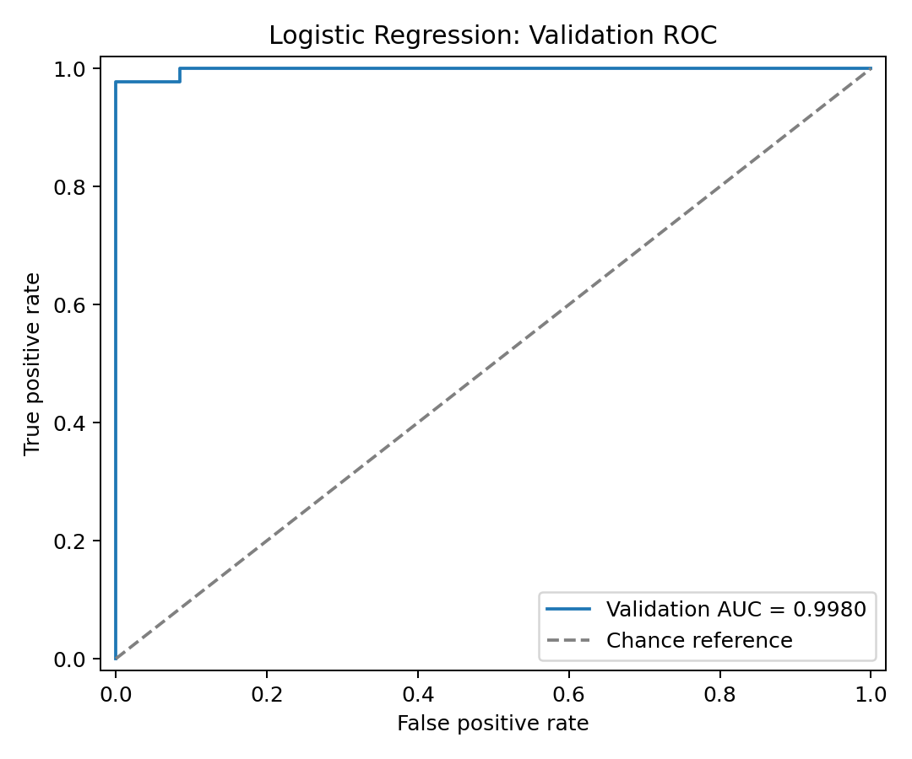

# Breast Cancer Classification — My First ML Baseline

这是我的第一个完整机器学习学习项目：使用 scikit-learn 自带的乳腺癌数据集，通过 StandardScaler 和 Logistic Regression 练习二分类评估。项目在 ChatGPT 指导下逐步完成；整理版也由 ChatGPT 协助重构。重点是理解流程、排错和解释结果，而非提出新算法。

## 数据与方法

数据由 `load_breast_cancer()` 加载，共569个样本、30个数值特征。这是表格特征分类，不是直接对医学图像训练CNN。原始标签为0=恶性、1=良性，本项目把恶性作为阳性。

两次分层划分均固定 `random_state=42`，最终训练集341、验证集114、测试集114。StandardScaler只在最终训练集拟合，验证集与测试集仅调用transform。模型保留原稿设置 `LogisticRegression(max_iter=100)`。

验证集比较0.5、0.3、0.1三个恶性概率阈值；最终测试保留默认基线阈值0.5，未根据测试结果调整。ROC使用恶性概率并显式指定 `pos_label=0`。

## 运行

在解压后的项目目录打开终端，建议使用Python虚拟环境：

```bash
python -m venv .venv
```

Windows PowerShell激活：

```powershell
.\.venv\Scripts\Activate.ps1
```

然后安装依赖并运行：

```bash
python -m pip install -r requirements.txt
python breast_cancer_baseline.py
```

若PowerShell不允许激活，可以直接使用 `.\.venv\Scripts\python.exe` 替代上述两条命令中的 `python`，无需修改执行策略。

程序打印结果，同时生成 `results/metrics.json` 和 `figures/roc_validation.png`。不会弹出图窗；可直接打开图片。依赖版本为整理版实际验证环境，不代表原学习电脑的版本。

## 结果

| 指标 | 验证集（阈值0.5） | 测试集（阈值0.5） |
|---|---:|---:|
| FN | 1 | 1 |
| FP | 0 | 1 |
| Accuracy | 99.12% | 98.25% |
| Sensitivity | 97.67% | 97.62% |
| Specificity | 100% | 98.61% |
| ROC AUC | 0.9980 | 0.9950 |

验证集阈值实验：

| 阈值 | FN | FP | 敏感度 | 特异度 |
|---|---:|---:|---:|---:|
| 0.5 | 1 | 0 | 97.67% | 100% |
| 0.3 | 1 | 2 | 97.67% | 97.18% |
| 0.1 | 0 | 7 | 100% | 90.14% |

降低阈值使更多样本被判为恶性；本例找回漏判的同时增加了误报。AUC衡量跨类别排序能力，不等于某一阈值下的准确率。



## 文件说明

- `breast_cancer_baseline.py`：精简可运行版本；重复评估代码整理为函数。
- `archive/original_learning_script.py`：保留原始上传代码作为学习记录，其plt.show()会等待图窗关闭。
- `requirements.txt`：整理版验证过的直接依赖版本。
- `results/metrics.json`：本次运行的数值结果。
- `figures/roc_validation.png`：验证集ROC图。

## 学习与排错记录

1. FN/FP曾命名颠倒：按真实类别和预测类别逐项核对，明确恶性标签0仍是阳性。
2. `.sum()`括号曾只覆盖一个条件：改为 `((条件1) & (条件2)).sum()`。
3. 编辑后终端仍显示旧结果：保存后重新运行完整脚本。
4. 图窗打开时后续输出不出现：认识到plt.show()会阻塞；整理版直接保存图片。
5. 标准化与分类训练不同：scaler学习每列均值和标准差，分类器学习特征与标签的关系。

## 局限与后续学习

这是小型公开数据集上的单次固定划分练习，没有外部验证或置信区间分析。结果不能推断为真实临床场景表现，预测概率也未进行专门的校准评估。测试结果已经查看，后续不能反复据此调参再宣称其为未见测试集。

下一阶段学习PyTorch张量、训练循环和小型MLP，逐步过渡到CNN医学图像项目。
